# AI for Documents and Research

```mermaid
%%{init: {"flowchart": {"nodeSpacing": 45, "rankSpacing": 65, "diagramPadding": 20}} }%%
flowchart TB
  subgraph Foundation["Where You're Starting From"]
    P1(["Previous Session<br/><b>Prompting Patterns: Chaining, Critique and Personas</b><br/><i>&#40;Chaining, Personas&#41;</i><br/>You learned to chain prompts, critique a model's own output, and build reusable templates."])
  end
  CS{{Current Session<br/><b>AI for Documents and Research</b><br/><i>Turning a free AI chat tool into a document-grounded research assistant, instead of a general-knowledge guesser</i><br/>Document Upload &amp; Summarising &middot; Grounding &middot; Knowledge Cutoff &middot; Fact-Checking}}
  subgraph Value["Why This Matters"]
    CV(["Course Value<br/><b>From General Prompting to Document-Grounded Answers</b><br/>Last session's chaining and templating techniques now get aimed at a specific, real source document, so the model's answer is checked against something concrete instead of trusted on its own."])
    RV(["Real-Life Value<br/><b>Why Your AI Tool Can Confidently Give You a Wrong Answer</b><br/>A free chat tool will happily summarise a 40-page report or guess at a recent event it was never trained on — grounding and fact-checking are what keep that confidence from becoming a mistake you ship."])
  end
  subgraph Future["Where This Leads Next"]
    F1(["Upcoming Session<br/><b>Colab, Variables and Condition Logic</b><br/><i>&#40;Python, Colab&#41;</i><br/>Shifts from prompting an AI tool conversationally into writing your own Python code, starting from variables and if/else logic."])
    F2(["Upcoming Session<br/><b>Loops and Tracing What Runs</b><br/><i>&#40;Loops, Python&#41;</i><br/>Builds on variables and conditions to repeat an action across many values instead of writing it out by hand."])
    F3(["Upcoming Module<br/><b>Module 2: Spreadsheet Analysis &amp; Dashboards</b><br/><i>&#40;Excel, Dashboards&#41;</i><br/>Moves from Python fundamentals into using spreadsheets for structured analytics and KPI tracking."])
  end
  P1 ==>|&nbsp;Technique &rarr; Documents&nbsp;| CS
  CS ==>|&nbsp;Course Path&nbsp;| CV
  CS ==>|&nbsp;Real-Life Use&nbsp;| RV
  CS ==>|&nbsp;Chat &rarr; Code&nbsp;| F1
  F1 ==>|&nbsp;Variables &rarr; Loops&nbsp;| F2
  F2 ==>|&nbsp;Python &rarr; Spreadsheets&nbsp;| F3
  classDef previous fill:#eef4ff,stroke:#4f7ccf,color:#111827,stroke-width:2px;
  classDef current fill:#fff4d6,stroke:#d9a321,color:#111827,stroke-width:3px;
  classDef value fill:#eaf8ef,stroke:#3f9f63,color:#111827,stroke-width:2px;
  classDef future fill:#f4ecff,stroke:#8a61d1,color:#111827,stroke-width:2px;
  class P1 previous;
  class CS current;
  class CV,RV value;
  class F1,F2,F3 future;
  linkStyle default stroke-width:3px
```



---

## What You'll Learn

In this pre-read, you'll discover:

- How to upload a document into a free AI chat tool and get a genuinely useful summary out of it
- Why telling a model to answer "only from this document" changes what it's allowed to use — and why that one instruction matters so much
- What a model's knowledge cutoff actually is, and why it can sound completely confident about something that happened after that date
- How to tell the difference between an AI claim that's actually grounded in your document and one that's quietly drifted into the model's general knowledge
- Why fact-checking every AI-generated claim against the source is a habit, not a one-time step

---

## Detailed Explanation

### Uploading and Summarising a Document Inside a Free AI Chat Tool

Most free AI chat tools — ChatGPT, Claude, Gemini — let you attach a file directly to a conversation: a PDF, a Word document, sometimes a spreadsheet. Once it's attached, the model can read its contents as part of the conversation, the same way it reads whatever you type.

The simplest use of this is summarisation: upload a report and ask for a summary. But a summary request is vague by default — "summarise this" can return three sentences or three pages depending on the model's mood. A useful summary request specifies length, audience, and focus: "Summarise this report in 150 words for someone who has never read it, focusing on the recommendations."

> **Starting habit:** Treat the upload as step one of two. Uploading a document doesn't yet tell the model to *only* use that document — that's a separate instruction, covered next.

---

### Grounding: Making the Model Answer Only From What You Gave It

Once a document is uploaded, the model still has its full general training knowledge available by default. Ask it a question and it may quietly blend what the document says with what it already "knows" — and you often can't tell which parts came from which source.

**Grounding means explicitly instructing the model to answer only using the supplied reference text, and to say so if the answer isn't present in it, rather than filling the gap from general knowledge.** This matters because an ungrounded answer can look exactly as confident and well-formatted as a grounded one, with no visible difference in tone.

```
UNGROUNDED PROMPT:
"What does this contract say about termination notice?"
-> may blend the actual contract clause with generic
   contract-law knowledge the model already has

GROUNDED PROMPT:
"Using ONLY the attached contract, what does it say about
termination notice? If it isn't covered in this document,
say so explicitly — do not use outside knowledge."
-> restricted to the document; a missing clause gets
   reported as missing, not invented
```

> **The one phrase that does the work:** "Using only the attached document" (or "based solely on the text above") is the specific instruction that triggers grounding — a bare upload plus a bare question does not.

---

### Knowledge Cutoff: Why "Out of Date" Isn't a Bug, It's a Boundary

Every AI model is trained on data collected up to a certain point in time, called its **knowledge cutoff**. Anything that happened after that point — a recent product launch, a policy change, last month's news — simply isn't in the model's training data, no matter how it's asked.

**A model's knowledge cutoff is the date after which it has no training data, so it cannot reliably know about events, prices, or facts that occurred after that point — and it will often still answer confidently instead of declining.** This matters for research tasks specifically, because a question like "what is the current version of this software" or "who holds this role now" is exactly the kind a cutoff silently breaks.

> **Watch out:** A confident tone is not evidence of a recent, accurate answer. For anything time-sensitive, check the model's stated cutoff and verify separately if the question is newer than that date.

---

### Fact-Checking: Classifying a Claim as Grounded or Unsupported

Grounding reduces the chance of an ungrounded claim slipping in — but it doesn't eliminate it. The model can still misread a document, generalise a specific number, or state something the document only implies rather than says outright.

**Fact-checking means taking each individual claim the model produced and checking it directly against the source document, sorting each one into grounded (the document actually states or clearly supports this) or unsupported (the document doesn't say this, even if it sounds plausible).** This matters because an unsupported claim embedded inside an otherwise accurate summary is the hardest kind of error to catch — everything around it reads correctly.

```
CLAIM: "The report recommends expanding into three new regions."
CHECK: Does the report's actual text name three regions and
       recommend expansion? -> GROUNDED if yes, UNSUPPORTED if
       it only discusses one region or doesn't recommend
       expansion at all
```

> **A working habit:** Read the model's output one claim at a time, not as a single block — a paragraph can be 90% grounded and 10% invented, and only claim-by-claim checking catches the 10%.

---

### Bringing It Together: A Repeatable Document-Research Workflow

Put in sequence, these four pieces form one repeatable workflow: upload the document, write a grounded prompt that restricts the model to that document, treat any date-sensitive part of the answer as subject to the knowledge-cutoff limitation, and fact-check every resulting claim against the source before using it anywhere.

This is the same shape of discipline that showed up last session with prompt chaining and self-critique — a technique only pays off once it's applied as a habit, every time, not as an occasional extra step.

> **Why this is the real skill:** Any AI tool can summarise a document. The actual, transferable skill this session teaches is checking that summary before you trust it — and that check doesn't go away as tools get better.

---

## Practice Exercises

**1. Pattern Recognition — Grounded, Ungrounded, or Cutoff-Limited?**

For each prompt below, classify it as (A) explicitly grounded, (B) not grounded even though a document was uploaded, or (C) at risk of a knowledge-cutoff problem regardless of grounding:

- "Based only on the attached meeting notes, who owns the follow-up action items?"
- "Summarise this PDF."
- "Using the attached annual report, what is this company's stock price today?"

---

**2. Spot The Error — The Confident Summary**

A student uploads a 20-page policy document and asks: "Summarise the key points." The model returns a clean, well-organised five-bullet summary. The student copies it straight into an email to their manager without reading the original document. What's wrong with this approach, and what two steps are missing before that email should be sent?

---

**3. Real-Life Application — Research for a Job Application**

You're applying to a company and want to understand their recent product direction. You upload their latest public annual report and ask the AI tool several questions about it. Write one grounded prompt you'd use, and explain what you would still need to verify separately, given the report's publication date versus today.

---

**4. Concept Detective — Right Document, Wrong Era**

A user uploads last year's employee handbook and grounds every prompt to it carefully, getting precise, well-cited answers throughout. Despite perfect grounding, every answer about "current" leave policy turns out to be wrong. Grounding was done correctly — so what actually went wrong here?

---

**5. Planning Ahead — A Document Research Checklist**

Before trusting any AI-generated answer from an uploaded document, build a short checklist a researcher should run through. It should cover at least: how the prompt was grounded, what the knowledge-cutoff risk is for this specific question, and how each claim will be fact-checked against the source.
