# Colab, Variables and Condition Logic

```mermaid
%%{init: {"flowchart": {"nodeSpacing": 45, "rankSpacing": 65, "diagramPadding": 20}} }%%
flowchart TB
  subgraph Foundation["Where You're Starting From"]
    P1(["Previous Session<br/><b>AI for Documents and Research</b><br/><i>&#40;Grounding, Fact-Checking&#41;</i><br/>You learned to ground an AI tool's answer to an uploaded document and fact-check its claims before trusting them."])
  end
  CS{{Current Session<br/><b>Colab, Variables and Condition Logic</b><br/><i>Moving from prompting an AI tool in plain English to writing your own instructions in Python</i><br/>Colab Cells &middot; Variables &amp; Data Types &middot; Type Conversion &middot; Operators &amp; If/Else}}
  subgraph Value["Why This Matters"]
    CV(["Course Value<br/><b>From Talking to a Model to Writing Your Own Logic</b><br/>Every data and machine-learning topic later in this course is written in Python — today is the first time you write and run that code yourself, instead of describing what you want in a prompt."])
    RV(["Real-Life Value<br/><b>Why &lsquo;If This, Then That&rsquo; Runs the World</b><br/>A discount that only applies above a minimum order value, a shipping fee that changes by weight, an eligibility rule that depends on age — all of it is if/else logic, the same shape you'll write today."])
  end
  subgraph Future["Where This Leads Next"]
    F1(["Upcoming Session<br/><b>Loops and Tracing What Runs</b><br/><i>&#40;Loops, Python&#41;</i><br/>Builds on variables and conditions to repeat an action across many values instead of writing it out by hand."])
    F2(["Upcoming Session<br/><b>Where LLMs Work and Fail</b><br/><i>&#40;AI Limitations, Masterclass&#41;</i><br/>Steps back from hands-on coding to examine where large language models genuinely struggle, grounded in what you now know about how deterministic code behaves."])
    F3(["Upcoming Module<br/><b>Module 2: Spreadsheet Analysis &amp; Dashboards</b><br/><i>&#40;Excel, Dashboards&#41;</i><br/>Moves from Python fundamentals into using spreadsheets for structured analytics and KPI tracking."])
  end
  P1 ==>|&nbsp;Chat &rarr; Code&nbsp;| CS
  CS ==>|&nbsp;Course Path&nbsp;| CV
  CS ==>|&nbsp;Real-Life Use&nbsp;| RV
  CS ==>|&nbsp;Conditions &rarr; Loops&nbsp;| F1
  F1 ==>|&nbsp;Code &rarr; Concepts&nbsp;| F2
  F2 ==>|&nbsp;Python &rarr; Spreadsheets&nbsp;| F3
  classDef previous fill:#eef4ff,stroke:#4f7ccf,color:#111827,stroke-width:2px;
  classDef current fill:#fff4d6,stroke:#d9a321,color:#111827,stroke-width:3px;
  classDef value fill:#eaf8ef,stroke:#3f9f63,color:#111827,stroke-width:2px;
  classDef future fill:#f4ecff,stroke:#8a61d1,color:#111827,stroke-width:2px;
  class P1 previous;
  class CS current;
  class CV,RV value;
  class F1,F2,F3 future;
  linkStyle default stroke-width:3px
```



---

## What You'll Learn

In this pre-read, you'll discover:

- How a Colab notebook separates code you run from notes you write, and why that separation matters
- How to store a value in a variable with a name that actually describes what it holds
- Why Python has more than one type of value, and how to tell them apart at a glance
- How to safely move a value between text, whole-number, and decimal form — and where that can quietly go wrong
- How arithmetic, comparison, and logical operators combine to answer yes/no questions about your data
- How to write branching logic that applies a different rule depending on the situation, exactly like a real business policy would

---

## Detailed Explanation

### Running Your First Colab Cell: Code vs. Markdown

A Google Colab notebook is built from cells, and a cell is one of exactly two kinds: a **code cell**, which Python actually executes when you run it, or a **markdown cell**, which renders formatted text and is never executed as code.

```
[ CODE CELL ]                    [ MARKDOWN CELL ]
print("Hello, Colab!")           # My Notes
                                  This explains what the
-> runs, prints output below     cell below it does.
   the cell                      -> renders as formatted
                                     text, nothing executes
```

Running a code cell (Shift+Enter, or the ▶ button) executes every line inside it, top to bottom, and shows any output directly underneath. A markdown cell never executes — it only displays.

> **Starting habit:** Keep code cells and markdown cells doing separate jobs from day one — markdown explains *why*, code does the *work*. Mixing explanation text into a code cell as an unstructured comment makes a notebook much harder to read later.

---

### Variables and Data Types: Storing and Classifying Values

A **variable** is a name you choose that points to a value, so you can refer to that value again later without retyping it. Python decides a variable's **data type** automatically, based on what you assign to it.

```python
student_name = "Aisha"      # str  (text)
student_age = 19            # int  (whole number)
attendance_rate = 92.5       # float (decimal number)
is_passing = True            # bool (True/False)
```

The four data types you'll meet constantly are **str** (text, in quotes), **int** (a whole number), **float** (a number with a decimal point), and **bool** (exactly `True` or `False`). You can always check a value's type directly:

```python
print(type(student_age))
```

```
<class 'int'>
```

> **Naming matters:** `student_age` tells the next reader exactly what the value is. A name like `x` or `temp1` works for Python but costs a future reader (including you, next week) real time figuring out what it holds.

---

### Type Conversion: Moving Between String, Int and Float

Values often arrive in the wrong type for what you need to do with them — a form field gives you text even when the answer is a number, and Python won't silently add a number to a piece of text for you.

```python
age_text = "19"
age_number = int(age_text)       # str -> int
price_number = 499.0
price_text = str(price_number)   # float -> str
rounded_price = int(price_number) # float -> int (drops the decimal part)
```

```
age_number     -> 19          (now usable in arithmetic)
price_text     -> "499.0"     (now usable in a sentence)
rounded_price  -> 499         (decimal portion is simply dropped, not rounded)
```

> **Watch out:** Converting a `float` to an `int` truncates — it cuts off the decimal part rather than rounding to the nearest whole number. `int(499.9)` gives `499`, not `500`.

---

### Arithmetic, Comparison and Logical Operators

Once values are the right type, Python's arithmetic operators compute with them, and comparison operators turn two values into a single `True`/`False` answer.

```python
total = 2500
installments = 4
print(total / installments)   # true division -> a float
print(total // installments)  # floor division -> whole installments only
print(total % installments)   # remainder left over
```

```
625.0
625
0
```

Comparison operators (`==`, `!=`, `>`, `<`, `>=`, `<=`) each produce a `bool`. Logical operators combine multiple `bool` values into one: `and` requires both sides to be true, `or` requires at least one side, and `not` flips a single value.

```python
order_total = 1800
is_member = True
qualifies = (order_total >= 1000) and is_member
print(qualifies)
```

```
True
```

> **A common trip-up:** `=` assigns a value to a variable; `==` checks whether two values are equal. Confusing the two is one of the most frequent early Python mistakes.

---

### If/Elif/Else: Branching Logic for a Business Rule

Real policies rarely apply the same way to everyone — a shipping fee that depends on order weight, a discount that depends on membership status, a grade band that depends on a score. Python expresses exactly this shape with `if`, `elif`, and `else`.

```python
score = 72

if score >= 90:
    grade = "A"
elif score >= 75:
    grade = "B"
elif score >= 60:
    grade = "C"
else:
    grade = "F"

print(grade)
```

```
C
```

Python checks each condition from top to bottom and stops at the first one that's `True` — the remaining `elif`/`else` branches are never even checked once a match is found. Order matters: if the 60 check came before the 75 check, a score of 80 would incorrectly stop at "C."

> **Ordering rule:** Arrange `elif` conditions from most specific (or highest threshold) to least specific — once Python finds a match, it stops checking, so a looser condition placed too early can silently catch cases meant for a stricter one below it.

---

## Practice Exercises

**1. Pattern Recognition — Which Type Is It?**

Classify each of the following values by the data type Python would assign automatically:

- A: `"42"`
- B: `42`
- C: `42.0`
- D: `False`

---

**2. Spot The Error — The Silent Truncation**

A student writes `discount_percent = int(12.9)` expecting `discount_percent` to hold `13`. What value does Python actually give it, and why does this happen?

---

**3. Real-Life Application — A Shipping Fee Rule**

A store charges free shipping for orders of ₹999 or more, a flat ₹49 fee for orders between ₹500 and ₹998, and a ₹99 fee for anything below ₹500. Write the if/elif/else logic (in plain pseudocode or real Python) that computes the correct shipping fee for a given `order_total`.

---

**4. Concept Detective — The Order That Changed the Answer**

A student writes grade logic starting with `if score >= 60: grade = "C"` as the *first* condition, followed by `elif score >= 90: grade = "A"`. A student who scored 95 gets a "C." What went wrong, and how does Python's top-to-bottom checking explain it?

---

**5. Planning Ahead — Designing a Membership Discount Rule**

Before writing any code, plan out (as a short checklist or decision tree) the conditions needed for this rule: members get 20% off any order, non-members get 20% off only if their order is above ₹2000, and otherwise no discount applies. Identify which variables you'd need and what data type each should be.
